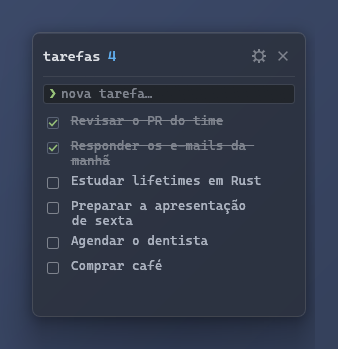

# todo-overlay

[](https://github.com/VitorCezila/todo-overlay/actions/workflows/ci.yml)
[](https://github.com/VitorCezila/todo-overlay/releases/latest)
[](LICENSE)

[🇧🇷 Português](README.md) · 🇺🇸 English

A to-do list that sits in the corner of your screen, always visible and never in the way.

todo-overlay is a small, semi-transparent, always-on-top window so you can glance at what's left to do without switching windows. A global shortcut (`Ctrl+Alt+T`) shows and hides it from anywhere. Written in Rust to be **genuinely lightweight**: a single ~5 MB `.exe`, no installer, no account, no internet.

> The app's interface is in **Brazilian Portuguese** for now. The actions are listed below with their on-screen labels.

<p align="center">
  
</p>

## Download and run

1. Download [`todo-overlay.exe`](https://github.com/VitorCezila/todo-overlay/releases/latest/download/todo-overlay.exe) from the [latest release](https://github.com/VitorCezila/todo-overlay/releases/latest).
2. Put it in a folder of your own, e.g. `%LOCALAPPDATA%\Programs\todo-overlay\`, and open it.
3. The first time, Windows may show "Windows protected your PC" (the `.exe` isn't code-signed). Click **More info → Run anyway**.

Requires only **Windows 10 or 11 (64-bit)** with a graphics driver installed. No Rust, .NET or extra runtime needed.

## What you can do

| Action | How |
|---|---|
| Show/hide the list | `Ctrl+Alt+T` (configurable) or click the tray icon |
| Add a task | Type in the "nova tarefa…" field and press `Enter` |
| Complete | Click the checkbox |
| Edit | Double-click the text (`Esc` cancels) |
| Delete | Hover and click the trash icon; made a mistake? Click **Desfazer** (undo) |
| Reorder | Hover and drag the ⠿ handle on the left of the task |
| Tabs (categories) | `+` creates a tab; double-click renames; right-click renames or deletes it (its tasks move to **Geral**). New tasks go to the active tab |
| Hide completed | Eye icon on the title bar (remembered) |
| Move / resize | Drag the title bar / the edges (position is remembered) |
| Settings | Gear icon or tray menu ("Configurações"): opacity, shortcut, start with Windows |

The X button and `Alt+F4` only hide the window; to quit, use **Sair** (quit) in the tray menu.

## Your data

Everything stays on your computer, in `%APPDATA%\todo-overlay\` (`tasks.json` and `config.json`). Nothing goes to the internet. Writes are atomic, and a corrupted file is kept as `.bak` instead of being deleted. When a `tasks.json` from an older version is opened, a copy of the original is kept as `tasks.json.v1.bak` (or the matching version).

## Footprint

Measured on v0.5.0 (Windows 11, RTX 3050):

| | Measured |
|---|---|
| `.exe` size | ~5 MB |
| Idle CPU | 0% |
| RAM | ~65 MB (mostly the GPU's OpenGL driver) |

About RAM: the app's own code uses a few MB; almost all the rest is the NVIDIA OpenGL driver (`nvoglv64.dll`), which is loaded into any program that renders with OpenGL. Numbers differ on other GPUs.

## Why not...

- **Sticky Notes**: free-form text notes, not a list to check off, and no global show/hide shortcut.
- **Microsoft To Do + PowerToys "Always on Top"**: works, but it's a full window (with borders, a Microsoft account and sync) for what is a translucent corner here.
- **Rainmeter widgets**: require installing Rainmeter and editing skins; todo-overlay is a single `.exe`.

If one of those already works for you, great. This one is for people who just want a light, local, always-visible list.

## How it was built

The project was developed with [Claude Code](https://claude.com/claude-code) (Anthropic's AI) as a pair programmer, with the author setting requirements and reviewing and testing every change. The process is versioned in the repository:

- [`CLAUDE.md`](CLAUDE.md): requirements, footprint targets, conventions, and the technical constraints discovered along the way (eframe with a hidden window, `WM_ENDSESSION`, AltGr on the Brazilian ABNT2 keyboard...).
- [`.claude/skills/`](.claude/skills): step-by-step playbooks for recurring tasks (new feature, new setting, data migration, release).
- [`.claude/agents/`](.claude/agents): specialized reviewers (code, performance, tests) used before each PR.

Every change went through a branch, a PR, `fmt`/`clippy`/tests and review. CI repeats those checks.

## For developers

Built with [Rust](https://www.rust-lang.org) and [egui](https://github.com/emilk/egui) (OpenGL backend), plus `global-hotkey` and `tray-icon`.

Prerequisites: [rustup](https://rustup.rs) (`winget install Rustlang.Rustup`) and Visual Studio Build Tools with "Desktop development with C++".

```powershell
cargo run                                   # development
cargo build --release                       # target\release\todo-overlay.exe
cargo fmt --check; cargo clippy --all-targets -- -D warnings; cargo test
```

The code lives in `src/`: `model.rs` and `storage.rs` hold the pure logic (no UI, with tests), `app.rs` the interface, and `hotkey.rs` the background thread with the shortcut, tray icon and Win32 calls. Identifiers and comments are in Portuguese. Issues and PRs are welcome (in English or Portuguese); CI (`.github/workflows/ci.yml`) runs the same checks on every PR.

### Release

The published `.exe` is built by GitHub Actions (`.github/workflows/release.yml`). To cut a release, bump `version` in `Cargo.toml` and push an annotated tag with the release notes:

```powershell
git tag -a v0.6.0 --cleanup=verbatim -F notas.md; git push origin v0.6.0
```

The release workflow runs fmt/clippy/tests, checks that the tag matches `Cargo.toml`, builds and publishes the release with the `.exe`.

## License

[MIT](LICENSE): use, modify and distribute freely, keeping the copyright notice.
