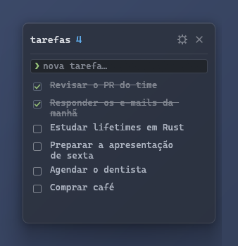

# todo-overlay

Uma to-do list que fica no cantinho da tela, sempre à vista e sem atrapalhar.

O todo-overlay é uma janela pequena, semitransparente e sempre no topo para você bater o olho no que falta fazer sem trocar de janela. Um atalho (`Ctrl+Alt+T`) mostra e esconde a lista de qualquer lugar. Feito em Rust para ser **leve de verdade**: um único `.exe` de ~5 MB, sem instalador, sem conta, sem internet.

<p align="center">
  
</p>

## Baixar e usar

1. Baixe o [`todo-overlay.exe`](https://github.com/VitorCezila/todo-overlay/releases/latest/download/todo-overlay.exe) da [última release](https://github.com/VitorCezila/todo-overlay/releases/latest).
2. Coloque-o numa pasta sua, por exemplo `%LOCALAPPDATA%\Programs\todo-overlay\`, e abra.
3. Na primeira vez, o Windows pode mostrar "O Windows protegeu o computador" (o `.exe` não tem assinatura digital paga). Clique em **Mais informações → Executar assim mesmo**.

Precisa só de **Windows 10 ou 11 (64 bits)** com o driver de vídeo instalado. Não precisa de Rust, .NET nem de nenhum runtime extra.

## O que dá para fazer

| Ação | Como |
|---|---|
| Mostrar/esconder a lista | `Ctrl+Alt+T` (dá para trocar) ou clique no ícone da bandeja |
| Adicionar tarefa | Digite no campo "nova tarefa…" e aperte `Enter` |
| Concluir | Clique na caixinha |
| Editar | Duplo clique no texto (`Esc` cancela) |
| Apagar | Passe o mouse e clique na lixeira; se errar, use **Desfazer** |
| Mover / redimensionar | Arraste pelo título / pelas bordas (a posição é lembrada) |
| Configurações | Engrenagem ou menu da bandeja: opacidade, atalho e iniciar com o Windows |

O X e o `Alt+F4` só escondem a janela; para fechar de vez, use **Sair** no menu da bandeja.

## Seus dados

Tudo fica no seu computador, em `%APPDATA%\todo-overlay\` (`tasks.json` e `config.json`). Nada vai para a internet. A gravação é atômica e, se um arquivo estiver corrompido, ele é guardado como `.bak` em vez de ser apagado.

## Leveza

Medido na v0.5.0 (Windows 11, RTX 3050):

| | Medido |
|---|---|
| Tamanho do `.exe` | ~5 MB |
| CPU parado | 0% |
| RAM | ~65 MB (a maior parte é do driver OpenGL da placa de vídeo) |

## Para desenvolvedores

Feito com [Rust](https://www.rust-lang.org) e [egui](https://github.com/emilk/egui) (backend OpenGL), mais `global-hotkey` e `tray-icon`.

Pré-requisitos: [rustup](https://rustup.rs) (`winget install Rustlang.Rustup`) e o Visual Studio Build Tools com "Desenvolvimento para desktop com C++".

```powershell
cargo run                                   # desenvolvimento
cargo build --release                       # target\release\todo-overlay.exe
cargo fmt --check; cargo clippy --all-targets -- -D warnings; cargo test
```

### Release

O `.exe` publicado é compilado pelo GitHub Actions (`.github/workflows/release.yml`). Para lançar uma versão, suba a `version` do `Cargo.toml` e envie uma tag anotada com as notas da versão:

```powershell
git tag -a v0.6.0 --cleanup=verbatim -F notas.md; git push origin v0.6.0
```

O CI roda fmt/clippy/testes, confere se a tag bate com o `Cargo.toml`, compila e publica a release com o `.exe`.
